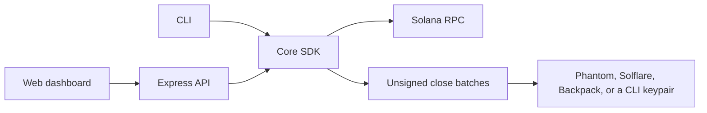

# solana-reclaim

Open-source Solana wallet rent scanner, dust guard, creator-fee surface check, and Token-2022 / holder radar.

Empty SPL token accounts are 165 bytes and lock **0.00203928 SOL** of rent. Token-2022 accounts with extensions lock more. Traders accumulate dozens of these after launches. Closed-source sweepers often keep 15–25% of what they recover. This project builds the `closeAccount` transactions itself and adds **no protocol fee**.

The scan is read-only. Nothing is signed until you ask a wallet, or a local keypair, to sign.



## Run it

```bash
npm install
npm test
npm run dev
```

The dashboard listens on [http://127.0.0.1:43123](http://127.0.0.1:43123) (`PORT` overrides the port, and the process binds `0.0.0.0`).

```bash
npm run cli -- scan 8RrMaJXYwANd4zEskfPQuSYE35dTzaYtuwyKz3ewcZQx
npm run cli -- audit EPjFWdd5AufqSSqeM2qN1xzybapC8G4wEGGkZwyTDt1v
npm run cli -- build-tx <wallet> --json
npm run build && npx solana-reclaim scan <wallet>
```

`build-tx` is a dry run unless you pass `--sign <keypair.json>`. `--send` also requires `--sign`. `--dry-run` together with `--sign` is rejected.

Set `SOLANA_RPC_URL` when the public endpoint rate-limits you. `SOLANA_RPC_FALLBACKS` is a comma-separated backup list. The client tries `https://api.mainnet-beta.solana.com` first, then `https://public.rpc.solanavibestation.com` and `https://solana-rpc.publicnode.com`. The official RPC often rejects `getTokenLargestAccounts`; the radar uses the next endpoint that still serves that indexed method.

## Captured mainnet example

These figures are a live read on 27 Oct 2026. Balances move, so treat them as a shape of the report, not a quote.

`scan 8RrMaJXYwANd4zEskfPQuSYE35dTzaYtuwyKz3ewcZQx` (public mainnet, about 0.3s):

| | |
| --- | --- |
| Native SOL | 1.386119165 (~$140 at ~$101/SOL) |
| Closeable rent | 0.00302768 SOL from 2 empty Token-2022 accounts |
| Dust | 1 account, 0.00151384 SOL rent if burned |
| Active | 3, including a USDC account left in place |
| Lookup tables | 16 owned, 0 past the close cooldown |
| PumpSwap creator wSOL | 0.001495524, shown separately and not closed |
| Close batches | 1 unsigned transaction, 0% protocol fee |

`audit` on the same day:

| Mint | Score | What stood out |
| --- | --- | --- |
| PYUSD | 18/100 high risk | Token-2022. Permanent delegate and a transfer hook. Top 10 holders ~85.5% of supply. |
| USDC | 95/100 lower structural risk | Mint and freeze authorities are the expected issuer keys. Top 10 ~29.8%. |
| BONK | 100/100 | Mint and freeze revoked. Top 10 ~38.5%. |

## What a scan reports

For each wallet:

1. Native SOL, via `getBalance`.
2. Every SPL Token and Token-2022 account owned by the wallet.
3. A category for each account:
   - **Reclaimable** — raw balance is zero, the account is not frozen, and Token-2022 withheld fees are zero. Rent is the account's actual lamports (2,039,280 for a standard 165-byte account, more when extensions make the account larger).
   - **Dust** — balance is above zero and below 1 whole token, and the mint is not on the protected list. Burn is off until you opt in.
   - **Active** — balance is at least 1 whole token, or any non-zero balance of a recognized mint (USDC, USDT, wSOL, PYUSD, liquid staking tokens, JUP, RAY, BONK, WIF, and a short major list).
   - **Locked** — frozen, uninitialized, unharvested Token-2022 withheld fees, or a confidential-transfer balance that is not proven empty.
4. Protocol surface:
   - pump.fun creator vault PDA `["creator-vault", wallet]`
   - PumpSwap wSOL creator-fee ATA under `["creator_vault", wallet]`
   - Address lookup tables whose authority is the wallet (when the RPC allows `getProgramAccounts`)
   - Recent signatures sampled for pump.fun, PumpSwap, Raydium, Meteora, Orca, Jupiter, and Jito

Creator-vault SOL is shown separately. The close batch does not claim it, and it does not close a PumpSwap fee account that still holds wSOL. Fee-sharing configs can move pump fees off the direct creator PDA; that path is named in the result, not guessed.

## Unsigned batches

`closeAccount` instructions are packed at **20 per transaction** (hard cap 24) and measured against the **1232-byte** packet limit. Each transaction starts with `ComputeBudgetProgram.setComputeUnitLimit` and, unless you set the price to 0, `setComputeUnitPrice`. The default price is 20,000 micro-lamports. That tip goes to the validator. There is no transfer to this project.

SPL Token and Token-2022 program ids are chosen per account. Output is base64, legacy by default, or `--format versioned`. The web signer refreshes the blockhash at build time and asks Phantom, Solflare, or Backpack to `signAndSendTransaction` only when the connected account matches the scanned wallet.

## Token radar

`audit` reads the mint, Token-2022 extensions, and `getTokenLargestAccounts`.

The composite score is the average of:

- an authority / extension score, and
- a distribution score from the top 1, top 5, and top 10 holders.

Known LP and launchpad custody is removed from the holder sample when the token-account owner is the Raydium v4 authority, a burn address, or an account owned by Raydium, Meteora, Orca, pump.fun, or PumpSwap. Percentages still use total supply as the denominator. The sample is only the top 20 accounts the RPC returns.

Critical findings (permanent delegate, non-transferable, a large transfer fee, or freeze combined with a transfer hook) cap the composite at 45. Recognized issuer mints such as USDC still show mint and freeze authorities, but those issuer controls are scored as expected and the composite is floored at 88 when nothing critical is present. Concentration numbers stay visible either way.

This is a heuristic. It is not an audit and it does not know intent.

## SDK

```ts
import { scanWallet, auditMint, buildUnsignedReclaimTransactions } from 'solana-reclaim'

const scan = await scanWallet('8RrMaJXYwANd4zEskfPQuSYE35dTzaYtuwyKz3ewcZQx')
const audit = await auditMint('EPjFWdd5AufqSSqeM2qN1xzybapC8G4wEGGkZwyTDt1v')

const batch = buildUnsignedReclaimTransactions({
  owner: scan.address,
  recentBlockhash,
  targets: scan.accounts.filter((account) => account.closeable).map((account) => ({
    pubkey: account.pubkey,
    programId: account.programId,
    lamports: account.lamports,
    mint: account.mint,
    amount: account.amount,
    decimals: account.decimals,
    closeable: account.closeable,
    burnable: account.burnable,
    protectedMint: account.protectedMint,
  })),
})
// batch.protocolFeeLamports === 0
// batch.transactions[0].base64 is ready for a wallet
```

`buildReclaimFromChain` re-fetches every selected account before it builds. A non-zero, frozen, or withheld-fee account is rejected instead of being closed.

## HTTP API

| Method | Path | Purpose |
| --- | --- | --- |
| `GET` | `/api/health` | Liveness. `?deep=1` also asks the RPC for a slot. |
| `GET` | `/api/scan/:wallet` | Read-only scan. Add `?wallets=a,b` for a batch of up to 10. |
| `GET` | `/api/audit/:mint` | Extension and concentration radar. |
| `POST` | `/api/build-reclaim-tx` | Unsigned close batch for `{ wallet, accounts, allowBurn? }`. |
| `POST` | `/api/send` | Relay a **signed** transaction. Unsigned payloads are rejected. |

The API does not accept an RPC URL from the client. Point the server at a private RPC with `SOLANA_RPC_URL` so a request cannot be turned into a fetch of an internal host.

`POST /api/build-reclaim-tx`

```json
{
  "wallet": "<owner>",
  "accounts": ["<token-account>"],
  "allowBurn": false,
  "priorityMicroLamports": 20000,
  "format": "legacy"
}
```

Omit `accounts` and the server selects every empty closeable account. Dust is never included unless it is listed and `allowBurn` is true. Recognized mints are never burned.

## Deploy

The app is stateless. Rent math and scans are computed per request. On Render the filesystem is ephemeral, which matches this service: nothing important is written to disk.

**Node**

```bash
npm ci
npm run build
PORT=43123 npm start
```

**Docker**

```bash
docker compose up --build
```

**Render**

`render.yaml` defines a Node web service, health check `/api/health`, and an optional `SOLANA_RPC_URL` you fill in on the dashboard (`sync: false`, so later blueprint syncs do not wipe it). The free instance sleeps after idle time. Set the RPC before you point real traffic at it; public mainnet endpoints throttle `getProgramAccounts` and large token-account scans.

The process reads `PORT` and binds `0.0.0.0`.

## Safety model

- Scans never request a signature.
- Default transactions only close zero-balance accounts.
- Frozen accounts and unharvested Token-2022 fees are excluded, even when a zero balance might otherwise close.
- Dust burn is a separate opt-in and is refused for recognized mints.
- The builder checks the chain again at build time.
- Priority fees are capped at 1,000,000 micro-lamports per compute unit.
- Local signing reads a Solana CLI keypair file and refuses a key that does not match the wallet. The server never accepts a secret key.
- Rate limit: 30 API scans per minute per IP.

## Development

```bash
npm test
npm run typecheck
npm run build
```

Tests cover classification, the 2,039,280 lamport rent constant, 20-close packet splits for SPL and Token-2022, versioned and legacy serialization, extension scoring, PDA seeds for pump creator vaults, and the Express routes.

## License

MIT. See [LICENSE](LICENSE).
